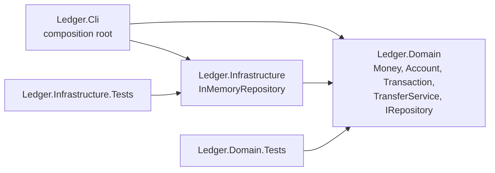

# Ledger

A banking ledger domain written in C# / .NET 10, built step by step as my path from frontend development to .NET.

> **Status:** active learning project. The domain layer is complete and tested; the Web API, database and UI are next.

## Why this project exists

I'm a frontend developer with ~3 years of commercial experience (React, Next.js, TypeScript). I'm moving into **C# / .NET**, aiming for a full-stack **React/Next.js + ASP.NET Core** role.

Instead of isolated tutorials, I'm learning by building one realistic system from the ground up: a small Revolut-style ledger. Every feature is introduced to learn a specific C# concept, then reviewed against the standards of a professional codebase (code review, tests, analyzers, small commits).

The rule I follow: **no AI autocomplete in this repo.** I write the code myself; reviews and explanations are how I learn.

## What it does today

- **Money as a value object.** Amount + currency, immutable, compared by value. Refuses more than 2 decimal places instead of silently rounding.
- **Accounts as entities.** Deposits and withdrawals with currency checks and insufficient-funds protection.
- **Balance is derived, never stored.** It's computed from the transaction history, the way a real ledger works.
- **Transfers between accounts** through a domain service, ordered so a failed transfer never leaves money half-moved.
- **Account statements.** Transactions by date range (newest first) and totals per transaction type, via LINQ.
- **Testable time.** `TimeProvider` is injected, so tests control the clock with `FakeTimeProvider`.
- **Repository abstraction + dependency injection.** The domain depends on `IRepository<T>`; an in-memory implementation lives in infrastructure and is wired up with `Microsoft.Extensions.DependencyInjection`.

## Architecture



Dependencies point **inward**: the domain knows nothing about consoles, databases or HTTP. When EF Core and ASP.NET Core arrive, the domain shouldn't change.

```
src/
  Ledger.Domain/            business rules, no external dependencies
  Ledger.Infrastructure/    implementations of domain abstractions
  Ledger.Cli/               console app wiring everything together
tests/
  Ledger.Domain.Tests/
  Ledger.Infrastructure.Tests/
```

## Design decisions

| Decision | Why |
|---|---|
| `Money` is a `readonly record struct` | Value semantics, immutability, equality by value |
| Reject amounts with >2 decimals | Silent rounding in finance is silent data loss |
| Negative `Money` is allowed | "No overdraft" is an account rule, not a property of money |
| Transaction amounts are always positive | Direction comes from `TransactionType`, not the sign |
| Balance computed with `Aggregate` | Single source of truth: the transaction history |
| Account exposes `IReadOnlyList<Transaction>` | State changes only through methods that enforce the rules |
| `TimeProvider` injected into `Account` | Time is a dependency; tests can control it |
| Withdraw before deposit in transfers | Every check that can fail runs before any state changes |
| Interfaces in Domain, implementations in Infrastructure | The domain stays independent of storage |

## Run it

Requires the [.NET 10 SDK](https://dotnet.microsoft.com/download).

```bash
dotnet build
dotnet test
dotnet run --project src/Ledger.Cli
```

## Roadmap

**C# fundamentals (through the domain)**
- [x] Value objects, records, operator overloading
- [x] Entities, encapsulation, custom exceptions
- [x] LINQ, domain services, testable time
- [x] Interfaces, generics, dependency injection
- [ ] async/await, `HttpClient`, live exchange rates from the Czech National Bank

**Web & data**
- [ ] ASP.NET Core Web API (controllers)
- [ ] EF Core + PostgreSQL
- [ ] Authentication: ASP.NET Core Identity + JWT
- [ ] Blazor WebAssembly client (MudBlazor)

**Production**
- [ ] Docker
- [ ] CI with GitHub Actions
- [ ] Deployment to Azure

## Stack

C# · .NET 10 · xUnit · Microsoft.Extensions.DependencyInjection · TimeProvider · JetBrains Rider
